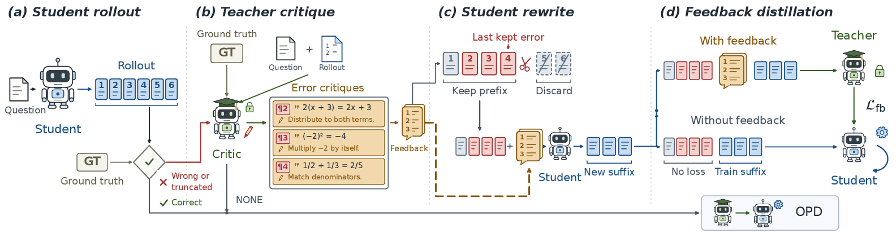
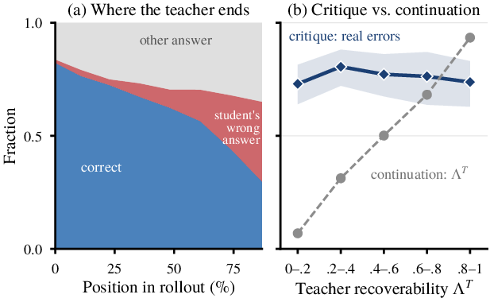
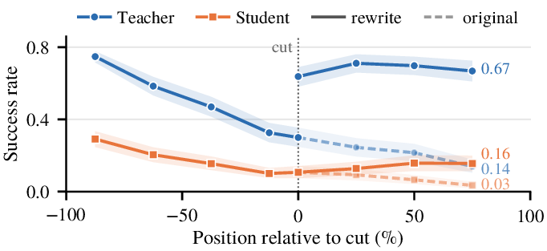
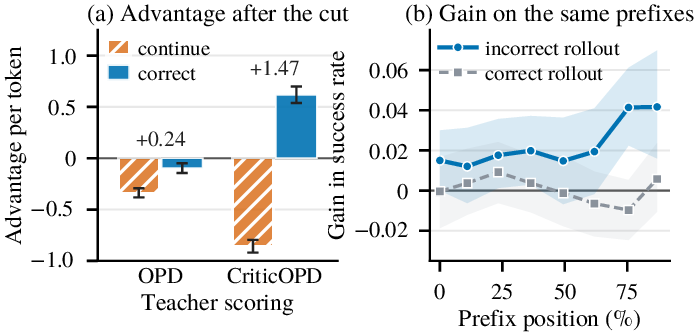
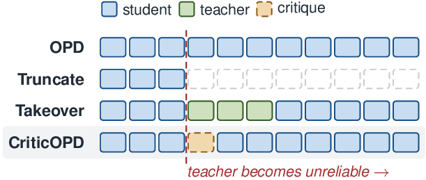

<div align="center">

<h2>Recovering Reliable Supervision via Critique-Guided On-Policy Distillation</h2>

<p>
Kaixiang Zhao<sup>1</sup>, Tianrun Yu<sup>1</sup>, Shangzhe Li<sup>2</sup>, Yuxiao Yang<sup>2</sup>, Amanda Hughes<sup>1</sup>, Weitong Zhang<sup>2</sup>, Taylor W. Killian<sup>1</sup><br>
<sup>1</sup>Brigham Young University &nbsp;&nbsp; <sup>2</sup>University of North Carolina at Chapel Hill
</p>

[](https://kzhao5.github.io/CriticOPD-website/)
[](https://arxiv.org/abs/2610.20572)
[](https://www.python.org/)
[](https://pytorch.org/)
[](https://github.com/zju-real/Relay-OPD)
[](https://github.com/vllm-project/vllm)
[](LICENSE)

</div>

<p align="center"></p>
<p align="center"><em>Overview of CriticOPD (Figure 2): (a) the student writes a rollout; (b) if it is wrong or truncated, the teacher critiques it with the reference answer as a guide; (c) the student keeps its prefix up to the last critiqued error and rewrites the rest with the critique in its context; (d) the teacher scores the rewrite with the critique in its context, and the student learns from the sequence without the critique. Correct rollouts are trained with standard OPD.</em></p>

## 🌌 Introduction

On-policy distillation (OPD) trains a student model on its own rollouts with token-level supervision from a teacher. This supervision assumes that the teacher can reach a correct answer from any prefix that the student writes. We call this property the **recoverability** of the teacher.

**Where the supervision fails.** On incorrect rollouts, recoverability declines as the prefix grows: the teacher increasingly continues the student's errors and ends with the student's wrong answer. Yet when it is asked to critique the same prefixes, the teacher still recognizes most of the errors, at every level of recoverability.

<p align="center"></p>
<p align="center"><em>Figure 4: (a) how the continuations of the teacher end on incorrect rollouts of the student; (b) the fraction of errors listed by the teacher that are real stays flat, while its success rate from the same prefixes spans the whole range.</em></p>

**How CriticOPD restores it.** CriticOPD turns error recognition into supervision. The teacher critiques an incorrect rollout, and the student rewrites its solution from the last error with the critique in its context. The teacher then scores the rewrite with the critique $c$ in its context, while the student learns from the sequence without it:

$$A_t^{\mathrm{fb}} = \log \pi_T(\tilde{y}_t \mid \tilde{h}_t, c) - \log \pi_\theta(\tilde{y}_t \mid \tilde{h}_t).$$

The critique serves as privileged information: every supervised token is written by the student, and the student needs no feedback at inference.

<p align="center">

&nbsp;

</p>
<p align="center"><em>Left (Figure 6): recoverability of the teacher and the student on original rollouts (dashed) and critique-guided rewrites (solid). Right (Figure 8): (a) with the critique in its context, the teacher assigns a large advantage to a continuation that corrects the error; (b) the trained student recovers more often from prefixes of incorrect rollouts.</em></p>

## 📰 News

- **[2026-10]** [Project page](https://kzhao5.github.io/CriticOPD-website/) online.
- **[2026-10]** Code release: CriticOPD, the baselines of the paper, and the evaluation protocol.
- **[2026-10]** The paper is on [arXiv](https://arxiv.org/abs/2610.20572).

## 📊 Results

Qwen3-1.7B student (non-thinking mode) distilled from Qwen3-4B-Instruct-2507 on DAPO-Math-17k. Accuracy (%) with a budget of 32,768 tokens, averaged over 32 samples per problem on AIME 2024, AIME 2025, and AMC 2023 and over 8 samples on MATH500, OlympiadBench, and Minerva Math; mean over three seeds at the selected step. Table 1 of the paper adds a Qwen3-0.6B student and all ten baselines.

| Method | Step | AIME24 | AIME25 | AMC23 | MATH500 | Olympiad | Minerva | Avg |
|---|:-:|:-:|:-:|:-:|:-:|:-:|:-:|:-:|
| OPD | 80 | 35.10 | 22.78 | 62.94 | 86.26 | 56.65 | 36.78 | 50.08 |
| OPSD-T | 60 | 37.08 | 23.51 | 63.64 | 86.85 | 57.47 | **37.53** | 51.01 |
| FastOPD | 60 | 40.97 | 26.25 | 66.08 | 87.28 | 58.01 | 36.73 | 52.55 |
| RelayOPD | 40 | 40.10 | 29.97 | 67.32 | 88.10 | 59.07 | 37.50 | 53.68 |
| **CriticOPD** | 40 | **41.11** | **30.14** | **69.88** | **88.87** | **60.45** | 37.44 | **54.65** |

CriticOPD reaches its selected step after 40 steps and uses 17.2 A100 GPU-hours, 0.42 times the training compute of OPD at step 80.

<details>
<summary><b>Where the supervision of each method falls (Figure 1)</b></summary>
<p align="center"></p>
<p align="center"><em>Truncation removes the supervision after the error, and takeover methods let the teacher write tokens into the trajectory. CriticOPD keeps the student's prefix and supervises a rewrite that the student writes after the critique.</em></p>
</details>

## ⚙️ Installation

CriticOPD builds on [Relay-OPD](https://github.com/zju-real/Relay-OPD), which is built on [verl](https://github.com/volcengine/verl). This repository holds only the files that CriticOPD adds or changes; `setup.sh` copies them onto Relay-OPD at a pinned commit.

```bash
git clone https://github.com/kzhao5/CriticOPD.git
cd CriticOPD
bash setup.sh                         # -> ./Relay-OPD (base commit eab2145) with CriticOPD added

conda create -n criticopd python==3.12 -y
conda activate criticopd
cd Relay-OPD
pip install -c environment/vllm-constraints.txt vllm==0.21.0
cd relay-opd
pip install -e .
pip install -r requirements-relay-opd.txt
python ../environment/verify_install.py
```

| Package | Version used in the paper |
|---|---|
| Python | 3.12 |
| PyTorch | 2.11 (CUDA 13.0) |
| vLLM | 0.21.0 |
| Transformers | 5.15 |
| Ray | 2.57 |
| Math-Verify | 0.9.0 |

A run on Qwen3-1.7B uses one node with four NVIDIA A100-80GB GPUs: two for the student and two for the teacher.

## 🚀 Quick Start

All commands run from `Relay-OPD/relay-opd`. The six evaluation benchmarks are in [`data/bench`](data/bench), and `data/prepare_dapo.py` creates the training prompts from [DAPO-Math-17k](https://huggingface.co/datasets/BytedTsinghua-SIA/DAPO-Math-17k).

```bash
python ../../data/prepare_dapo.py          # -> data/dapo-math-17k.parquet (17,917 problems)

export STUDENT_MODEL=Qwen/Qwen3-1.7B
export TEACHER_MODEL=Qwen/Qwen3-4B-Instruct-2507
export TRAIN_DATA=$PWD/../../data/dapo-math-17k.parquet
export BENCH=$PWD/../../data/bench

# train CriticOPD (40 steps, checkpoints every 20 steps)
SEED=42 OUTPUT_DIR=$PWD/runs/criticopd_seed42 bash opd/scripts/criticopd/train.sh

# evaluate the checkpoint at step 40
MODEL=runs/criticopd_seed42/global_step_40/actor/huggingface DATA_DIR=$BENCH \
OUT_ROOT=$PWD/eval RUN_NAME=criticopd_seed42 STEP=40 bash opd/scripts/criticopd/eval.sh
```

`train.sh` reproduces the final configuration of the paper on Qwen3-1.7B. Its behavior is set by environment variables:

| Variable | Default | Meaning |
|---|---|---|
| `CRITIC_OPD_ENABLE` | `1` | `0` gives plain OPD |
| `CRITIC_OPD_GIVE_GT` | `1` | the critic receives the reference answer |
| `CRITIC_OPD_KERR` | `last` | the critic lists all errors and the student keeps its prefix through the `k`-th one (`1`, `2`, `3`, or `last`) |
| `CRITIC_OPD_CRITIC_TOKENS` | `2048` | length limit of the critique; an incomplete last error is discarded |
| `CRITIC_OPD_FB_ANSWER` | `1` | the feedback ends with "The correct final answer is …" |
| `CRITIC_OPD_LOSS` | `fb` | `fb`: the teacher scores the rewrite with the feedback; `clean`: without it |
| `CRITIC_OPD_FB_MODE` | `critique` | `generic`: a fixed generic hint; `answer`: the reference answer only |
| `CRITIC_OPD_REWRITER` | `student` | `teacher`: the teacher writes the suffix after the cut point |

During training, the log reports the share of rollouts that are rewritten (`critic_opd/repair_seq_frac`) and the share of training tokens that come from rewrites (`critic_opd/repair_tok_frac`).

## 🔬 Reproducing the Paper

### Main table

`baseline.sh` runs every baseline of the paper with the settings of Table 1 and stops at the step selected there. `SIZE` chooses the student.

```bash
SIZE=1.7B SEED=42 OUTPUT_ROOT=$PWD/runs bash opd/scripts/criticopd/baseline.sh relayopd
```

| Method | `baseline.sh` | Step (1.7B / 0.6B) | Notes |
|---|---|:-:|---|
| SFT | `sft` | 40 / 139 | cross-entropy on teacher solutions |
| KD | `kd` | 139 / 139 | top-128 forward KL on teacher solutions |
| GRPO | `grpo` | 120 / 80 | binary reward, 8 rollouts per prompt |
| Critique-GRPO | `cgrpo` | 40 / 40 | 7 rollouts per prompt plus one refinement after the critique |
| OPD | `opd` | 80 / 40 | sampled-token reverse-KL objective |
| OPSD-T | `opsdt` | 60 / 80 | the teacher scores with the reference answer in its context |
| FastOPD | `fastopd` | 60 / 40 | training responses of at most 8,192 tokens |
| TRD | `trd` | 40 / 139 | top-128 forward KL on teacher rewrites |
| SKD | `skd` | 120 / 40 | speculative decoding, top-5 acceptance |
| RelayOPD | `relayopd` | 40 / 60 | teacher takeovers at reflection tokens |
| CriticOPD | `train.sh` | 40 / 40 | |

SFT and KD train on one teacher solution per prompt, and TRD trains on teacher rewrites of student solutions. Create these files first and pass them in `OFFLINE_DATA`:

```bash
MODE=teacher OUTPUT_PARQUET=$PWD/offline/teacher.parquet bash opd/scripts/criticopd/offline_data.sh
MODE=trd     OUTPUT_PARQUET=$PWD/offline/trd_1.7B.parquet bash opd/scripts/criticopd/offline_data.sh
OFFLINE_DATA=$PWD/offline/teacher.parquet SIZE=1.7B OUTPUT_ROOT=$PWD/runs bash opd/scripts/criticopd/baseline.sh kd
```

### Ablations and sensitivity

```bash
OUTPUT_ROOT=$PWD/runs bash opd/scripts/criticopd/ablation.sh no_fb_scoring
```

| Variant | Change from the final configuration |
|---|---|
| `no_answer` | the feedback contains only the critique |
| `answer_only` | the feedback states only the reference answer |
| `generic` | the feedback is a fixed generic hint |
| `teacher_suffix` | the teacher writes the suffix after the cut point |
| `no_fb_scoring` | the teacher scores the suffix without the feedback |
| `k1`, `k2`, `k3` | the student keeps its prefix through the k-th listed error |
| `limit512`, `limit1024`, `limit4096` | length limit of the critique |

### Evaluation

`eval.sh` samples with temperature 1.0 and top-p 1.0 and allows up to 32,768 new tokens. It reports avg@32 on AIME 2024, AIME 2025, and AMC 2023 and avg@8 on MATH500, OlympiadBench, and Minerva Math, together with their average. Answers are graded with Math-Verify.

| AIME 2024 | AIME 2025 | AMC 2023 | MATH500 | OlympiadBench | Minerva Math |
|:-:|:-:|:-:|:-:|:-:|:-:|
| 30 | 30 | 83 | 500 | 675 | 272 |

## 🧩 Repository Layout

```
setup.sh                              clones Relay-OPD at the pinned commit and adds the files below
overlay/                              mirrors relay-opd/ of Relay-OPD
  verl/experimental/agent_loop/
    critic_opd_agent_loop.py          CriticOPD: grading, critique, cut point, rewrite; also OPSD-T and Critique-GRPO
    agent_loop.py                     teacher scoring of the rewrite with the feedback (L_fb)
  verl/trainer/ppo/                   Critique-GRPO advantage and loss, rewrite metrics
  verl/trainer/distillation/          distillation losses
  verl/workers/, verl/utils/          rollout, engine, and config changes used by the baselines
  opd/scripts/criticopd/
    train.sh                          CriticOPD with the final configuration
    ablation.sh                       ablations and sensitivity analysis
    baseline.sh                       all baselines with the settings of Table 1
    offline_data.sh                   teacher solutions (SFT, KD) and teacher rewrites (TRD)
    eval.sh                           evaluation protocol of the paper
  opd/scripts/baselines/, relay_opd/  baseline training scripts of Relay-OPD with our changes
  opd/data/, opd/eval/, opd/patches/  offline data generation, evaluation, speculative decoding
data/
  prepare_dapo.py                     training prompts: one copy of each DAPO-Math-17k problem (17,917)
  bench/                              the six evaluation benchmarks
assets/                               figures used in this README
```

## 📖 Citation

If you find this work useful, please cite:

```bibtex
@article{zhao2026recovering,
  title   = {Recovering Reliable Supervision via Critique-Guided On-Policy Distillation},
  author  = {Zhao, Kaixiang and Yu, Tianrun and Li, Shangzhe and Yang, Yuxiao and Hughes, Amanda and Zhang, Weitong and Killian, Taylor W.},
  journal = {arXiv preprint arXiv:2610.20572},
  year    = {2026}
}
```

## 🤝 Acknowledgments

Training builds on [Relay-OPD](https://github.com/zju-real/Relay-OPD) and [verl](https://github.com/volcengine/verl), with rollouts served by [vLLM](https://github.com/vllm-project/vllm) and answers graded by [Math-Verify](https://github.com/huggingface/Math-Verify). We thank the authors of the baselines for releasing their implementations.

## 📄 License

This project is released under the [Apache License 2.0](LICENSE). The files in `overlay/` are derived from Relay-OPD and verl and are distributed under the same license.
